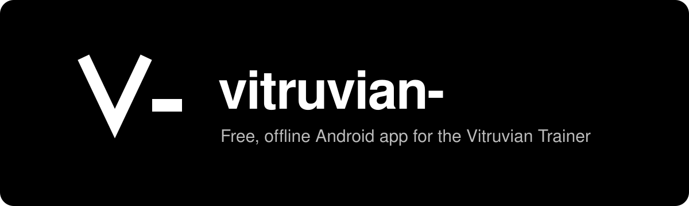
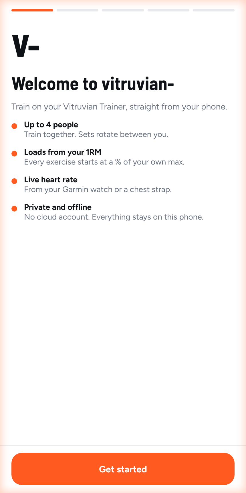
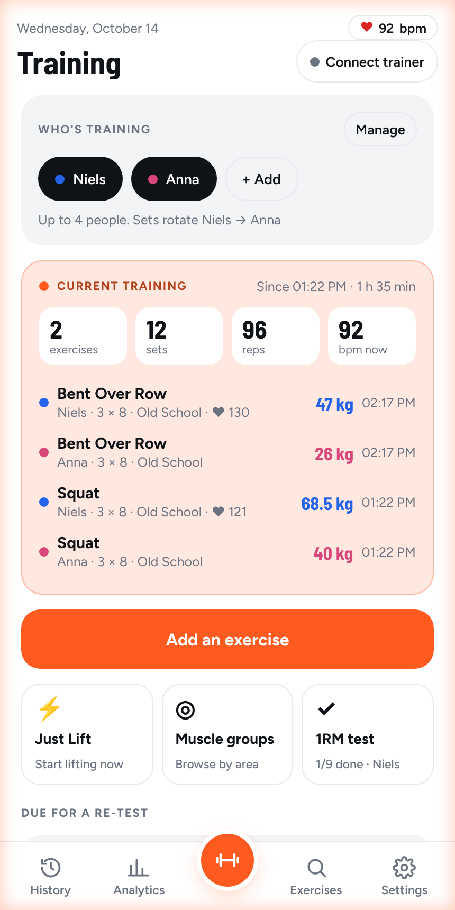
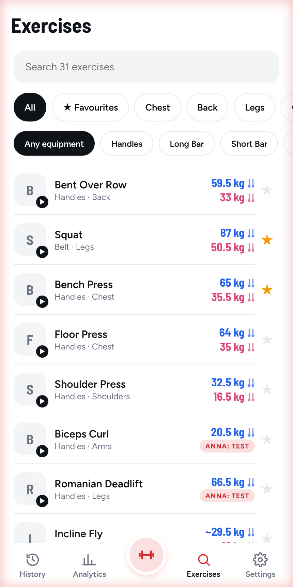
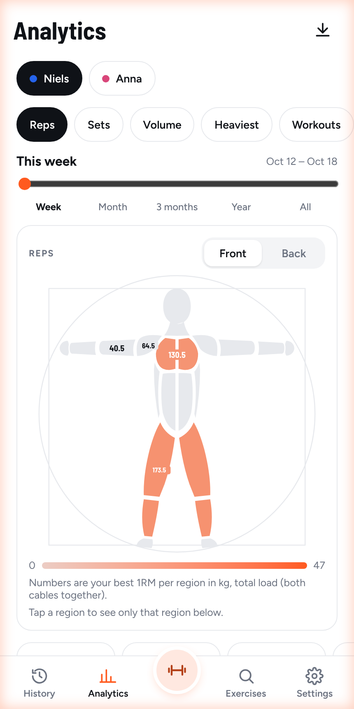

<p align="center">
  
</p>

<p align="center">
  <a href="https://github.com/NielsNotsmurf/Cable-4-Vitruvian/releases/latest"></a>
  <a href="https://github.com/NielsNotsmurf/Cable-4-Vitruvian/releases"></a>
  
  <a href="LICENSE"></a>
  <a href="https://github.com/sponsors/NielsNotsmurf"></a>
  <a href="https://github.com/ImranR98/Obtainium"></a>
</p>

<h1 align="center">Cable: free app for the Vitruvian Trainer+ &amp; V-Form</h1>

<p align="center">
  <b>Cable: an unofficial app for the Vitruvian V-Form &amp; Trainer+.</b><br>
  Train without a subscription. Not affiliated with Vitruvian.<br>
  Black and white, offline, no cloud accounts. Talks to the trainer directly over Bluetooth.<br>
  <a href="#install">Install</a> · <a href="https://nielsnotsmurf.github.io/Cable-4-Vitruvian/demo/">Live demo</a> · <a href="#features">Features</a> · <a href="#changelog">Changelog</a> · <a href="https://github.com/NielsNotsmurf/Cable-4-Vitruvian/issues/new?template=feedback.yml">Feedback</a>
</p>

> [!NOTE]
> Cable is an unofficial, independent community project for the Vitruvian V-Form and Trainer+.
> It is not affiliated with, made, endorsed or supported by Vitruvian. "Vitruvian", "V-Form" and
> "Trainer+" are trademarks of their owner and are only
> used here to say which hardware the app works with. Use it at your own risk.

## Why Cable

| | |
|---|---|
| **Free, for good** | No subscription, no ads, no tracking. MIT licensed. |
| **Offline first** | Everything stays on your phone. Back up to a single JSON file. |
| **Train together** | Up to 4 lifters per session, sets rotate, each with their own 1RM and PIN. |
| **Smart loading** | Loads as a % of your 1RM, with estimated 1RMs for 362 exercises. |
| **Auto updates** | Install once with Obtainium and new versions arrive by themselves. |

<!-- This README grows with the app: every change that adds or changes a feature also adds a line to Features and Changelog. -->

## Screenshots

<p align="center">
  
  
  
  
</p>

**Try it in your browser:** the [live demo](https://nielsnotsmurf.github.io/Cable-4-Vitruvian/demo/) is a
clickable web version with a simulated trainer and example lifters. Nothing to install.

## Features

- **First launch:** a short onboarding picks or creates your account, offers a PIN, explains
  Garmin heart rate and offers the app tour.
- **Local accounts:** every profile is an account. A PIN (4 to 6 digits, stored only as a salted
  hash) is asked when the app opens as you, before a protected profile joins a training, and
  before it's deleted. Others on the phone don't see a protected profile's history until it's
  unlocked. A forgotten PIN is reset with the phone's own screen lock.
- **App tour:** arrows and a dimmed overlay point out every part of the app, including Garmin
  heart rate pairing. Each account's tour status is remembered; replay it from Settings → Help.
- **Lifters:** up to 4 people train together and sets rotate between them. Each lifter has a
  profile, a colour and their own defaults.
- **Clean layout:** the default screens. They're built in `:clean-ui`, and
  [clean-ui/FEATURES.md](clean-ui/FEATURES.md) lists every feature and where it lives.
- **% of 1RM loading:** each lifter's 1RM shows next to every exercise, and loads default to a
  percentage of it. A guided 1RM test fills it in. One tested lift gives an estimated 1RM
  for every related exercise (bench 25 kg means incline about 22.5 kg), shown as "estimated"
  until you test it. The ratios are in `clean-ui/src/androidMain/assets/one_rep_max_map.json`.
- **All trainer modes:** Old School, Pump, TUT, TUT Beast, Eccentric Only and Echo, with
  per-set reps, weights, rest, AMRAP and timed sets.
- **Workout builder:** pick one or more muscle groups and a time, and the app builds the
  workout with each lifter's % of 1RM. Swap any exercise for one on other equipment; exercises
  on the same equipment sit next to each other so you switch as little as possible.
- **Exercise library:** a short description per exercise, search by name, muscle (forearms, glutes,
  …) or equipment, body-region and muscle filters, favourites and video demos.
- **Moving through a workout:** end a set early, skip or redo a set, jump to the next exercise, change
  the % of 1RM for the coming sets, and leave the workout running to pick it up again from home.
- **1RMs you control:** only the 1RM test or your own entry sets a 1RM; tap one in Analytics to correct it.
- **Live heart rate:** pair a Garmin watch broadcast or a chest strap per lifter. HR shows
  during a set and in history.
- **History and analytics:** workouts, personal records and volume over time. Analytics opens
  on a Vitruvian body map: each region is coloured by the measure and period you pick (reps,
  volume, … this week, this year, …) and shows its heaviest load. Those two filters drive the
  whole screen: trend bars, headline numbers, insights, balance and exercise cards.
- **Sounds:** short synthesized bops and boops for every tap, screen change and dialog, plus
  workout sounds for the countdown, each rep, warm-up done, set done, records, the end of rest and
  1RM attempts. "Menu sounds" and "Workout beeps" each have a switch in Settings; music keeps playing.
- **Backup and restore:** a full JSON backup saved to `Download/Cable`.
- **Theme:** black and white, with light and dark modes.
- **Settings:** grouped as Account, People, Training, Sound and video, Trainer LED colour,
  Help, Data, and Advanced (connection logs, protocol tester, classic layout) folded away.

## Install

Android only (Android 8 or newer) and free.

1. Install [Obtainium](https://github.com/ImranR98/Obtainium/releases) on your phone or tablet.
   It installs apps straight from GitHub and keeps them updated.
2. In Obtainium, tap **Add app**, paste `https://github.com/NielsNotsmurf/Cable-4-Vitruvian` and
   tap **Add**, then **Install**. Allow Obtainium to install apps when Android asks.
3. Open Cable, follow the welcome steps and connect to your trainer over Bluetooth.

Without Obtainium: open [Releases](https://github.com/NielsNotsmurf/Cable-4-Vitruvian/releases)
on your phone and tap the `.apk` of the latest version. You then have to repeat this for
every update.

### Web app (beta, iPhone, iPad and any browser)

Cable also runs as a web app with the same screens, at
[nielsnotsmurf.github.io/Cable-4-Vitruvian/app](https://nielsnotsmurf.github.io/Cable-4-Vitruvian/app/).
It can feel a little slower than the Android app, and it explains itself on first launch.

- **Android, Windows, Mac:** open it in Chrome or Edge and choose **Install app**. The trainer
  and heart rate straps connect over Bluetooth, as in the app.
- **iPhone and iPad, to look around or plan:** open it in Safari, tap **Share**, then **Add to
  Home Screen**. Apple allows no Bluetooth there, so sets run on a simulated trainer.
- **iPhone and iPad, to train with your trainer:** install
  [Bluefy](https://apps.apple.com/app/bluefy-web-ble-browser/id1492822055) (free) and open the
  same link in it. Bluefy adds the Bluetooth that Safari lacks.

Each browser keeps its own data on the device. Settings, Backup and restore saves it to a file.

Every merge to `master` builds a signed APK and publishes it as a release. How the signing
works is in [docs/RELEASES.md](docs/RELEASES.md).

## FAQ

**Is there a free alternative to the official Vitruvian app?**
Yes, Cable. It is a free, open-source Android app for the Vitruvian V-Form and Trainer+ that
connects to the trainer directly over Bluetooth, without a subscription or cloud account.

**Does it work with my V-Form or Trainer+?**
Cable is made for both and talks to them over the trainer's Bluetooth LE protocol. If something
does not work on your unit, please
[open an issue](https://github.com/NielsNotsmurf/Cable-4-Vitruvian/issues).

**Is it official?**
No. Cable is an independent community project, not affiliated with or endorsed by Vitruvian.

**iPhone?**
Not yet. Cable is Android only (Android 8 or newer).

**Will I lose my data from the official app?**
Cable does not touch your Vitruvian account. Your Cable workouts stay on your phone and can be
backed up to a single JSON file.

## Build

```sh
./gradlew :app:assembleDebug
```

Modules: `:app` (trainer connection, data, classic screens) and `:clean-ui` (the Clean layout,
no imports from `:app`).

## Changelog

- **2026-10-26:** a small landing page on GitHub Pages and better image descriptions, so search engines find Cable.
- **2026-10-21:** new screenshots in the Cable look.
- **2026-10-20:** move through a workout: end a set early (6 of 8 reps still counts) and go on,
  skip or redo a set, or jump to the next exercise during rest. Back leaves the workout running so
  you can check Analytics, and a "Workout running" bar picks it up again. The % of 1RM slider stays
  on the lifting screen and changes every lifter's coming sets. Home groups the current training per
  exercise. Just Lift is gone from home. Every exercise has a short description, and search and
  filters find muscles such as forearms. A 1RM only changes through the 1RM test or by hand: tap a
  1RM in Analytics to correct it.
- **2026-10-19:** FAQ for people looking for an alternative Vitruvian app, and store listing
  text (fastlane) for F-Droid repos such as IzzyOnDroid.
- **2026-10-19:** rebranded to **Cable**, an unofficial app for the Vitruvian V-Form and Trainer+. New
  cable-and-pulley icon, splash and banner, and a red accent by default. Updates keep working.
- **2026-10-16:** Settings has a "Training load · % of 1RM" slider (default 60%) that every exercise and
  built workout starts at. Built workouts let you change sets, reps and each lifter's load before you
  start. While the trainer gets ready, counts down or does the warm-up reps you can change the weight
  (during warm-up the warm-up restarts). The exercise video now loads in the background, so it plays
  by the time the countdown starts.
- **2026-10-16:** sounds everywhere: taps, screen changes and dialogs bop (Settings › Menu
  sounds), and the live workout and 1RM test now beep for countdown, reps, set done, records and
  end of rest (Settings › Workout beeps).
- **2026-10-16:** sets and reps per exercise come only from Settings ("Sets per exercise",
  "Reps per set"), never from what you did last time; change them on the set-up screen just before
  you start. The live screen plays the exercise video during get-ready, countdown and warm-up reps,
  and the "Classic" view button is gone.
- **2026-10-16:** new Train home: one dark "Build a workout" card as the main action, then One
  exercise / Just Lift, "Do again" chips and one 1RM card (test + re-tests). The separate muscle
  groups screen and duplicate buttons are gone.
- **2026-10-16:** workout builder by muscle group and time, with equipment-aware swaps. Reps per
  set come from Settings, and only the 1RM test changes a tested 1RM (normal sets no longer do).
  The body map shows chest and back 1RMs as total load (both cables).
- **2026-10-14:** the body map shows each region's best 1RM as total load (both cables), and the
  1RM list shows totals with the per-cable load next to them.
- **2026-10-14:** estimated 1RMs for 362 exercises, scaled from your tested lifts.
- **2026-10-13:** first-launch onboarding, local accounts with a PIN, an arrow-and-overlay app
  tour, and Settings regrouped. The Clean layout is now on by default for new installs.
- **2026-10-13:** new Analytics screen with a body map, measure and period filters, trend
  bars, insights and exercise cards. Clean lifting screen during a set.
- **2026-10-13:** rebranded to vitruvian-. New black and white theme, a "V-" icon and splash,
  and no more Phoenix branding.
- **2026-10-13:** signed APK releases on every master push, and live Garmin heart rate.
- **2026-10-12:** Clean layout, per-lifter 1RM and % loading.

## Support

Cable is free and stays free. If it saves you a subscription and you want to say thanks,
you can [sponsor me on GitHub](https://github.com/sponsors/NielsNotsmurf). Stars, bug reports
and sharing the app with other Vitruvian owners help just as much.

## Credits

Cable started as a fork of the MIT-licensed
[Vitruvian Project Phoenix](https://github.com/9thLevelSoftware/VitruvianProjectPhoenix)
Android app, and thanks everyone who reverse-engineered the trainer's BLE protocol. The
original licence notice is kept in [LICENSE](LICENSE).
